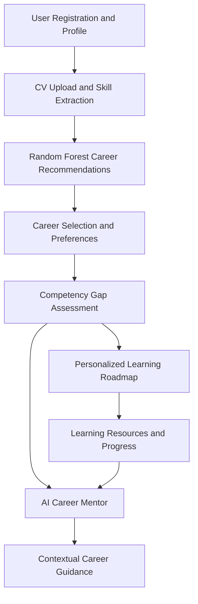
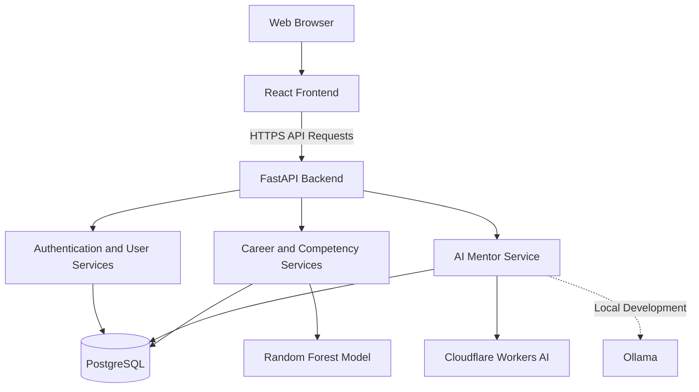

# CareerForge

**An AI-powered career recommendation and mentorship platform for technology professionals.**

CareerForge helps users explore technology careers, understand how their existing skills relate to career requirements, identify competency gaps, and follow personalized learning pathways.

The platform combines machine learning, structured career and skill data, and conversational AI to provide practical, context-aware career guidance.

**Live Application:** https://careerforgeapp.me
**Repository:** https://github.com/justpmn/careerforge
**Status:** Deployed — Active Development

## Overview

Choosing a career path in technology can be challenging, particularly when individuals are uncertain about how their current skills, qualifications, and experience align with different roles.

CareerForge addresses this problem by bringing career discovery, skill assessment, learning recommendations, and AI-assisted mentorship into a single platform.

Rather than relying solely on generic career descriptions, the system uses information from a user's CV, recorded skills, career preferences, and competency assessments to generate personalized guidance.

CareerForge currently focuses on technology-related careers.

## Key Features

### Career Recommendations
- Analyze uploaded CVs to identify technical skills.
- Generate ranked career recommendations using a Random Forest classifier.
- Support 22 technology career categories.
- Incorporate user career preferences into recommendations.
- Present model scores alongside documented skill coverage.

### Competency and Skill Assessment
- Compare recorded skills against career competency requirements.
- Distinguish evidenced, self-reported, and unassessed competencies.
- Identify areas requiring additional learning or evidence.
- Support competency evidence submissions and review.

### Personalized Learning Roadmaps
- Generate learning pathways based on the selected career.
- Recommend learning resources mapped to relevant skills and competencies.
- Track user-reported learning progress.
- Visualize learning pathways through an interactive skill tree.

### AI Career Mentor
- Provide conversational guidance based on the user's career profile.
- Discuss career recommendations, competency gaps, and learning resources.
- Maintain conversation history across sessions.
- Support contextual follow-up questions.
- Use background generation jobs so users can continue navigating while responses are generated.

The AI Mentor supports two inference providers:

- **Cloudflare Workers AI:** Google Gemma 4 for cloud-hosted inference.
- **Ollama:** Qwen3.5 for local development and experimentation.

### User Accounts and Personalization
- Email and password authentication.
- Google and GitHub OAuth sign-in.
- Email verification and password recovery.
- Career preferences and account settings.
- Configurable appearance themes.

### Administration and Monitoring
- Administrative dashboard and system health monitoring.
- Learning resource management and skill mapping.
- User administration and access controls.
- Multi-factor authentication for administrative access.
- Operational logging and AI inference monitoring.

## How CareerForge Works

CareerForge combines several processes to produce personalized career guidance.



Users can revisit their assessments, update their learning progress, and continue AI Mentor conversations as their career interests develop.

## Technology Stack

| Component | Technology |
|---|---|
| Frontend | React, TypeScript, Vite |
| Styling | Tailwind CSS, CSS |
| Routing | React Router |
| Client-side caching | TanStack Query |
| Learning visualizations | React Flow |
| Backend | Python, FastAPI, Pydantic |
| Database | PostgreSQL |
| ORM and migrations | SQLAlchemy, Alembic |
| Machine learning | Scikit-learn, Pandas, NumPy, Joblib |
| Local AI inference | Ollama, Qwen3.5 |
| Cloud AI inference | Cloudflare Workers AI, Google Gemma 4 |
| Authentication | JWT, OAuth 2.0, MFA |
| Testing | Pytest, Playwright |
| Version control | Git, GitHub |

## System Architecture

CareerForge follows a modular client-server architecture.



### Production Infrastructure

| Service | Hosting |
|---|---|
| Frontend | Cloudflare Pages |
| Backend API | Microsoft Azure Virtual Machine |
| Database | Neon PostgreSQL |
| AI inference | Cloudflare Workers AI |
| Source code | GitHub |

The frontend is accessible at https://careerforgeapp.me.

The backend exposes the application's API at https://api.careerforgeapp.me.

The Random Forest recommendation model runs within the backend application, while conversational AI requests are sent to the configured inference provider.

## Repository Structure

```text
careerforge/
├── src/
│   ├── backend/
│   │   ├── app/
│   │   │   ├── api/
│   │   │   ├── core/
│   │   │   ├── database/
│   │   │   ├── schemas/
│   │   │   └── services/
│   │   └── README.md
│   │
│   ├── frontend/
│   │   ├── src/
│   │   │   ├── components/
│   │   │   ├── context/
│   │   │   ├── lib/
│   │   │   └── pages/
│   │   ├── package.json
│   │   └── README.md
│   │
│   ├── preprocessing/
│   └── recommendation/
│
├── migrations/
├── scripts/
├── tests/
├── data/
├── .env.example
├── docker-compose.yml
├── alembic.ini
├── requirements.txt
└── README.md
```

The backend contains the API, business logic, data access, authentication, and AI integration services.

The frontend contains the user interface, routing, state management, API clients, and visual components.

The preprocessing and recommendation packages provide functionality for extracting skills and generating machine learning predictions.

## Getting Started

These instructions provide an overview of local setup. Refer to the component-specific documentation for detailed configuration and troubleshooting.

### Prerequisites

Install the following tools:

- Python and pip
- Node.js and npm
- Git
- PostgreSQL, or Docker with Docker Compose
- Ollama, if using local AI inference

A compatible Python environment and the required trained model artifacts and database records are necessary for the full recommendation functionality.

### 1. Clone the Repository

```bash
git clone https://github.com/justpmn/careerforge.git
cd careerforge
```

### 2. Set Up the Python Environment

Create a virtual environment:

```bash
python -m venv .venv
```

Activate it on Windows PowerShell:

```powershell
.\.venv\Scripts\Activate.ps1
```

Or on Linux/macOS:

```bash
source .venv/bin/activate
```

Install the backend dependencies:

```bash
python -m pip install -r requirements.txt
```

### 3. Configure Environment Variables

Create a local environment file from the provided example.

Windows PowerShell:

```powershell
Copy-Item .env.example .env
```

Linux/macOS:

```bash
cp .env.example .env
```

Update the configuration values for your development environment.

Important configuration includes:

- PostgreSQL connection details
- Authentication and OAuth secrets
- Frontend origin and cookie settings
- Email delivery configuration
- AI inference provider settings

A secure `OAUTH_STATE_SECRET_KEY` must be configured before the backend can start.

Do not commit `.env`, API tokens, passwords, or other secrets to version control.

### 4. Start PostgreSQL

If using Docker Compose, configure the PostgreSQL values in `.env`, then run:

```bash
docker compose up -d postgres
```

Ensure that `DATABASE_URL` matches the running PostgreSQL instance.

Apply database migrations:

```bash
python -m alembic upgrade head
```

The application also requires appropriate career, skill, and learning-resource data. Refer to the backend documentation for data initialization.

### 5. Start the Backend

From the repository root:

```bash
python -m uvicorn src.backend.app.main:app --reload --port 8000
```

The backend will run at:

http://127.0.0.1:8000

Interactive API documentation:

http://127.0.0.1:8000/docs

### 6. Start the Frontend

Open another terminal:

```bash
cd src/frontend
npm ci
npm run dev
```

Access the frontend at:

http://localhost:5173

Vite proxies `/api` requests to the local FastAPI backend. The proxy target can be configured through the frontend environment settings.

### 7. Configure AI Inference

CareerForge supports local and cloud-hosted AI inference.

For local development with Ollama:

```dotenv
LLM_PROVIDER=ollama
OLLAMA_MODEL=qwen3.5:4b
OLLAMA_BASE_URL=http://127.0.0.1:11434
```

Ollama must be running with the configured model installed.

For Cloudflare Workers AI:

```dotenv
LLM_PROVIDER=cloudflare
CLOUDFLARE_ACCOUNT_ID=YOUR_ACCOUNT_ID
CLOUDFLARE_AI_API_TOKEN=YOUR_PRIVATE_TOKEN
CLOUDFLARE_MODEL=@cf/google/gemma-4-26b-a4b-it
```

Cloudflare inference requires a valid Cloudflare account and Workers AI API token.

Keep provider credentials in the backend environment only. Never expose them through frontend variables.

## Machine Learning Approach

CareerForge uses a Random Forest classifier to generate ranked recommendations across 22 technology career categories.

The recommendation workflow includes:

1. Extracting technical skills from CV text.
2. Matching identified skills against the model's feature vocabulary.
3. Transforming matched skills into model-compatible features.
4. Generating career classification scores.
5. Ranking career recommendations and applying user preferences.
6. Comparing documented skills against career competency requirements.

### Data Sources

The project uses structured career and technical skill information, including:

- Stack Overflow Developer Survey data
- O*NET occupational information
- Curated technology career and competency mappings

The training pipeline includes data preprocessing, skill normalization, feature engineering, and model evaluation.

The Random Forest model provides recommendation signals rather than definitive judgments about career suitability or professional competence.

## Testing

CareerForge includes backend tests and frontend browser tests.

### Backend

From the repository root:

```bash
python -m pytest tests
```

Some integration tests require a dedicated test database or additional environment configuration.

### Frontend

From `src/frontend`:

```bash
npm run typecheck
npm run build
npx playwright test
```

Playwright also includes a separate configuration for tests involving the real FastAPI backend and a dedicated local PostgreSQL test database.

Consult the frontend README before running database-backed end-to-end tests.

## Documentation

Detailed developer guides are available for each application component:

- [Backend Documentation](src/backend/README.md) — API architecture, database setup, recommendation system, AI Mentor, testing, and deployment.
- [Frontend Documentation](src/frontend/README.md) — React architecture, application pages, components, themes, routing, caching, and testing.

## Security and Responsible AI

CareerForge processes user-provided career information, including CV content and recorded skills.

The platform includes authentication, account access controls, administrative MFA, and configuration-based secret management.

Depending on the configured AI inference provider, relevant career and assessment context may be transmitted to that provider to generate mentor responses.

CareerForge distinguishes recorded skill information, user-reported learning progress, and competency evidence from independently verified proficiency.

AI-generated recommendations may contain inaccuracies and should be reviewed critically.

Users should avoid submitting unnecessary sensitive information.

## Current Status and Future Work

CareerForge is deployed and remains under active development.

Current development priorities include:

- Improving profile caching and selective data preloading.
- Refining competency assessment consistency.
- Improving learning-resource retrieval and recommendation grounding.
- Evaluating AI Mentor response quality and inference latency.
- Expanding automated testing and production monitoring.
- Improving accessibility, performance, and reliability.

## Contributing

Issues and pull requests can be submitted through GitHub.

Contributors should use descriptive commit messages, document significant changes, and run relevant tests before submitting pull requests.

New features and fixes should generally be developed in separate branches before merging into `main`.

## Disclaimer

CareerForge is an academic software project intended to support career exploration and learning decisions.

Machine learning predictions, competency assessments, and AI-generated guidance are advisory and do not guarantee employment, professional qualification, or career suitability.

## License

This repository does not currently include a published open-source license. Permission for reuse or redistribution should be obtained from the project maintainer.
