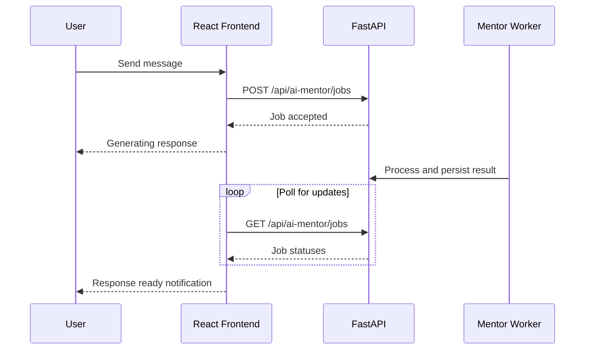

# CareerForge Frontend

The CareerForge frontend is a responsive web application built with React, TypeScript, and Vite. It provides an interface for exploring technology careers, analyzing CVs, assessing competencies, tracking learning progress, and interacting with an AI career mentor.

The application communicates with the CareerForge FastAPI backend through same-origin API requests.

**Live Application:** https://careerforgeapp.me
**Main Repository:** [CareerForge](../../README.md)
**Backend Documentation:** [Backend README](../backend/README.md)

## 1. Technology Stack

| Technology | Purpose |
|---|---|
| React 19 | Component-based user interface |
| TypeScript | Static typing and development tooling |
| Vite 7 | Development server and production builds |
| React Router 7 | Client-side routing and navigation |
| TanStack Query 5 | Server-state caching and synchronization |
| React Flow | Interactive learning roadmap |
| Dagre | Skill-tree graph layout |
| Tailwind CSS 4 | Utility-based styling |
| CSS | Application themes, layouts, and components |
| React Icons | Interface icons |
| React Markdown | Rendering AI Mentor responses |
| Playwright | End-to-end browser testing |

## 2. Application Features

### Career Dashboard

The authenticated dashboard provides access to the user's career information and primary application features, including career recommendations, competency assessments, learning roadmaps, and AI mentorship.

### CV Analysis

Users can upload a PDF or DOCX CV to extract technical skills and generate career recommendations.

The upload interface supports drag-and-drop and validates files before submission.

Supported uploads:

- PDF and DOCX formats
- Maximum file size of 5 MB
- Non-empty files only

The frontend displays extracted skills, model-recognized skills, and ranked career recommendations.

### Competency Assessment

Users can review their recorded skills, inspect career requirements, and submit self-assessments.

Self-assessment levels include Beginner, Intermediate, and Advanced.

Self-reported proficiency is distinguished from evidence identified through other assessment sources.

### Learning Roadmap

The learning roadmap uses an interactive skill-tree interface built with React Flow.

It enables users to:

- Explore competencies associated with a selected career.
- Inspect individual skill nodes.
- View competency information and relevant evidence.
- Access learning resources.
- Record learning progress.
- Navigate related learning requirements.

Dagre is used to organize the graph layout.

### AI Career Mentor

The mentor interface provides persistent, context-aware career conversations.

Features include:

- Conversation history
- Conversation renaming and deletion
- Markdown-formatted responses
- Contextual career guidance
- Background response generation
- Job status monitoring
- Completion and failure notifications

The AI model runs through the backend, not in the browser.

### Administration

Administrative interfaces provide access to:

- System overview and health information
- User administration
- Operational logs
- Learning resource catalog management
- Resource-to-skill mapping
- Administrative verification workflows

Authorization is enforced by the backend.

## 3. Project Structure

```text
src/frontend/
├── e2e/
├── e2e-real/
├── functions/
│   └── api/
│       └── [[path]].js
├── public/
├── scripts/
├── src/
│   ├── components/
│   ├── context/
│   ├── hooks/
│   ├── lib/
│   ├── pages/
│   ├── App.tsx
│   ├── main.tsx
│   └── *.css
├── .env.example
├── index.html
├── package.json
├── package-lock.json
├── playwright.config.ts
├── playwright.real.config.ts
├── vite.config.ts
└── README.md
```

### Directory Responsibilities

| Directory | Purpose |
|---|---|
| `components/` | Reusable interface components |
| `context/` | Shared authentication, appearance, and mentor job state |
| `hooks/` | Reusable React hooks |
| `lib/` | API clients, TypeScript types, caching, and application utilities |
| `pages/` | Route-level page components |
| `public/` | Static assets |
| `functions/` | Cloudflare Pages server-side functions |
| `e2e/` | Browser tests |
| `e2e-real/` | Browser tests using the real backend |
| `scripts/` | Frontend testing and development utilities |

## 4. Installation

### Prerequisites

- Node.js compatible with the project's Vite version
- npm
- Git
- A running CareerForge backend for API-dependent features

### Clone the Repository

```bash
git clone https://github.com/justpmn/careerforge.git
cd careerforge/src/frontend
```

### Install Dependencies

```bash
npm ci
```

The project includes a `package-lock.json` file, allowing npm to install the recorded dependency versions.

### Configure the Frontend Environment

Copy the example configuration.

Windows PowerShell:

```powershell
Copy-Item .env.example .env
```

Linux/macOS:

```bash
cp .env.example .env
```

For local development:

```dotenv
BACKEND_PROXY_TARGET=http://127.0.0.1:8000
VITE_GOOGLE_OAUTH_START_PATH=/api/auth/oauth/google/start
VITE_GITHUB_OAUTH_START_PATH=/api/auth/oauth/github/start
```

OAuth also requires correctly configured provider credentials and callbacks on the backend.

`BACKEND_PROXY_TARGET` is read by Vite during development. It is not a browser-exposed API key.

### Start the Development Server

```bash
npm run dev
```

Open:

http://localhost:5173

The backend should be running separately on the configured proxy target, normally:

http://127.0.0.1:8000

## 5. Application Routing

React Router handles client-side navigation.

Routes are defined in `src/App.tsx`.

### Public and Authentication Routes

| Route | Page |
|---|---|
| `/` | Public homepage |
| `/login` | Login |
| `/signup` | Registration |
| `/verify-email` | Email verification |
| `/forgot-password` | Password recovery |
| `/reset-password` | Password reset |
| `/auth/callback` | OAuth callback |
| `/auth/mfa` | Administrator MFA |
| `/delete-account` | Account deletion confirmation |

### Authenticated Routes

| Route | Page |
|---|---|
| `/dashboard` | Career dashboard |
| `/profile` | User profile |
| `/cv` | CV analysis / Experience |
| `/skills-assessment` | Competency assessment |
| `/roadmap` | Learning roadmap |
| `/mentor` | AI Career Mentor |
| `/settings` | Account and appearance settings |
| `/admin` | Administration dashboard |
| `/admin/resources` | Learning resource administration |

The application uses `GuestOnly` and `Protected` route wrappers to manage navigation based on authentication state.

These client-side guards improve the user experience but do not replace backend authorization.

## 6. Reusable Components

CareerForge separates route-level pages from shared interface components.

Examples include:

| Component | Responsibility |
|---|---|
| `AppShell.tsx` | Shared application shell |
| `AuthLayout.tsx` | Authentication page layout |
| `Brand.tsx` | CareerForge identity and logo |
| `ThemeToggle.tsx` | Light/dark theme control |
| `cvuploadmodal.tsx` | CV upload and validation dialog |
| `skillmapnode.tsx` | Custom roadmap graph nodes |
| `competencyassessmentpanel.tsx` | Competency self-assessment |
| `AdminTotpModal.tsx` | Administrative verification interface |

The main page container and workspace navigation are composed through the application layouts.

Components should remain reusable where practical, with page-specific logic kept in route components or extracted into hooks and utilities.

## 7. Application State

CareerForge uses React Context for shared application state and TanStack Query for cached server data.

### Authentication Context

`src/context/AuthContext.tsx`

The authentication provider handles:

- Current authenticated user
- Initial session restoration
- Login
- Registration
- Logout
- Session refresh

The application checks the authenticated session when it loads.

### Appearance Context

`src/context/appearancecontext.tsx`

The appearance provider controls the application's visual theme.

Supported appearances:

**Cozy**

- Light mode
- Dark mode

**Neon**

- Dedicated dark visual style

Appearance preferences are maintained in browser storage and synchronized with the backend for authenticated users.

### AI Mentor Jobs Context

`src/context/mentorjobscontext.tsx`

This provider manages AI Mentor generation jobs across the application.

It tracks:

- Queued jobs
- Running jobs
- Completed jobs
- Failed jobs
- Submission state
- Completion notifications

Because it is mounted above the application's routes, users can navigate away from the mentor page while a response is being generated.

## 8. Data Fetching and Caching

TanStack Query handles server-state caching across several application features.

The shared query client is configured in:

`src/lib/queryclient.ts`

### Current Default Configuration

| Setting | Value |
|---|---|
| Stale time | 2 minutes |
| Garbage collection time | 30 minutes |
| Refetch on window focus | Disabled |
| Retry count | 1 |

Frequently accessed data is assigned structured query keys.

Examples include:

- Career catalog
- Selected career
- Recorded skills
- Saved CV analysis
- Career recommendations
- Competency assessments
- Learning roadmaps
- Learning progress
- Administrative data

User-specific query keys incorporate a user identifier to distinguish account data.

### Cache Invalidation

Queries are invalidated or updated when relevant data changes.

The authentication provider clears the query cache during login and logout, reducing the possibility of retaining another account's cached application data.

The initial session check currently uses the authentication API directly rather than relying on a cached authentication query.

Caching is intended to reduce unnecessary requests while keeping saved user information synchronized with the backend.

## 9. AI Mentor Job Lifecycle

The AI Mentor uses a persistent backend job queue instead of relying on a single long-running browser request.

### Request Workflow



The frontend polls the jobs endpoint approximately every three seconds while the authenticated job provider is mounted.

Tracked job IDs are also stored in browser local storage to assist with restoring notification tracking.

The authoritative job and conversation records remain in PostgreSQL through the backend.

### Completion Notifications

When a previously tracked job completes, the application can show:

**Your response is ready.**

Users can navigate to the associated conversation from the notification.

A failed job displays an error notification instead.

## 10. API Integration

Frontend API clients are primarily located in `src/lib/`.

Examples include:

- `auth.ts`
- `resume.ts`
- `mentor.ts`
- `roadmap.ts`
- `onboarding.ts`
- `learningprogress.ts`
- `competencyassessments.ts`

These modules handle API requests and expose typed functions to React components.

The application generally uses relative `/api` paths with browser credentials included where authentication is required.

### Local Development Proxy

Vite forwards `/api/*` requests to FastAPI.

Configuration: `vite.config.ts`

```ts
server: {
  port: 5173,
  proxy: {
    '/api': {
      target: env.BACKEND_PROXY_TARGET ||
        'http://127.0.0.1:8000',
      changeOrigin: true,
    },
  },
}
```

This allows frontend code to make same-origin requests without hardcoding backend URLs.

### Production API Proxy

The production frontend uses a Cloudflare Pages Function:

`functions/api/[[path]].js`

This function forwards `/api/*` requests to:

https://api.careerforgeapp.me

It preserves request information for the upstream API, handles redirects back to the frontend origin where appropriate, and sets `Cache-Control: no-store` on proxied responses.

The development Vite proxy is not used in production.

The Cloudflare Pages Function must be included when deploying the frontend so authenticated API requests continue to work.

## 11. UI and Design System

CareerForge uses a custom visual identity built around readable typography, consistent spacing, responsive layouts, and distinct appearance modes.

The frontend combines Tailwind CSS with application-specific stylesheets.

### Main Styling Files

| File | Purpose |
|---|---|
| `styles.css` | Global styling |
| `dashboard.css` | Dashboard interface |
| `career.css` | Career-related interface styling |
| `neon.css` | Neon appearance |
| `responsive.css` | Responsive layout adaptations |
| `mentor.css` | AI Mentor interface |
| `roadmap.css` | Interactive roadmap |
| `skill-assessment.css` | Competency assessment |
| `homepage.css` | Public landing page |

Additional CSS files provide styles for specific pages and components.

### Responsive Design

The application is designed for desktop and smaller screens.

When introducing new components, verify that layouts remain usable at narrower viewport widths.

### Accessibility

Development should preserve:

- Semantic HTML
- Accessible labels
- Keyboard navigation
- Visible interaction states
- Clear form errors
- Appropriate loading and notification feedback

The project uses ARIA labels and live regions in selected interactive components, including upload dialogs and AI Mentor notifications.

Accessibility testing remains an ongoing development priority.

## 12. Testing

### TypeScript Validation

```bash
npm run typecheck
```

### Production Build

```bash
npm run build
```

This runs TypeScript project build checks and generates the production output in `dist/`.

### Preview the Production Build

```bash
npm run preview
```

This previews the built frontend locally.

### Playwright Tests

Install the Chromium browser required by the Playwright configuration:

```bash
npx playwright install chromium
```

Run the standard frontend browser tests:

```bash
npx playwright test
```

The standard configuration is:

`playwright.config.ts`

It uses Chromium and starts the Vite development server when necessary.

### Real Backend End-to-End Tests

A separate Playwright configuration exists:

`playwright.real.config.ts`

These tests run with the real FastAPI application and a dedicated local PostgreSQL test database.

The expected test database is:

`careerforge_test`

The repository includes a wrapper for browser tests and test-account cleanup:

```bash
node scripts/run-real-e2e.mjs
```

Before running it, configure `CAREERFORGE_TEST_DATABASE_URL` to reference the dedicated local test database and satisfy the backend test prerequisites.

The test configuration explicitly rejects remote databases and databases not named `careerforge_test`.

The wrapper preserves test accounts for debugging when a run fails and attempts cleanup following a successful run.

Never configure integration tests to target a production database.

## 13. Production Deployment

The frontend is deployed using Cloudflare Pages.

**Production Website:** https://careerforgeapp.me

### Build Configuration

| Setting | Value |
|---|---|
| Framework | React / Vite |
| Project root | `src/frontend` |
| Build command | `npm run build` |
| Output directory | `dist` |
| Package manager | npm |

Cloudflare Pages also deploys the `functions/` directory to handle application API proxy requests.

### Deployment Workflow

1. Push changes to the configured GitHub branch.
2. Cloudflare Pages builds the frontend.
3. The production bundle is generated in `dist/`.
4. Cloudflare serves the frontend through the configured domain.
5. The Pages Function proxies API traffic to the Azure-hosted backend.

The deployed backend, database, and AI inference infrastructure are maintained separately.

### Production Checklist

Before publishing changes:

- Run TypeScript validation.
- Build the frontend successfully.
- Verify authentication and protected navigation.
- Verify `/api/*` proxy requests.
- Test CV upload and recommendations.
- Check roadmap interactions.
- Check AI Mentor job notifications.
- Review responsiveness and browser console errors.

Do not expose private API keys through variables prefixed with `VITE_`, because these can be included in the client bundle.

## 14. Troubleshooting

### Frontend Cannot Connect to the Backend

Confirm that FastAPI is running and `BACKEND_PROXY_TARGET` points to the correct local service.

### Login Appears to Succeed but the Session Is Missing

Check browser cookies, frontend and backend origins, secure cookie configuration, and the authentication API responses.

### OAuth Redirect Fails

Verify the OAuth client settings, configured redirect origins, and backend provider credentials.

### CV Analysis Fails

Confirm the uploaded file is a supported PDF or DOCX smaller than 5 MB. Check backend model availability and the recommendation API.

### Learning Roadmap Does Not Load

Check the selected career, competency data, API responses, and browser console.

### AI Mentor Remains in a Generating State

Check the jobs endpoint, authentication session, backend worker status, and configured LLM provider.

### Changes Do Not Appear After Deployment

Confirm the latest commit was deployed, inspect the Cloudflare Pages build logs, and reload the application.

## 15. Development Guidelines

- Prefer reusable components for shared interface elements.
- Keep backend communication in typed API utilities.
- Reuse existing contexts and query keys.
- Invalidate or update cached data after mutations.
- Avoid duplicating API requests unnecessarily.
- Preserve authentication and CSRF handling.
- Maintain consistent styling across Cozy and Neon themes.
- Test significant changes on desktop and mobile viewports.
- Keep sensitive credentials out of client-side code.
- Add or update tests when changing application behavior.

## Related Documentation

- [Main Project README](../../README.md)
- [Backend README](../backend/README.md)

## Disclaimer

CareerForge provides machine learning-assisted career recommendations and AI-generated mentorship for informational and educational purposes.

Recommendations and self-reported skill assessments do not independently certify professional competence or guarantee employment.